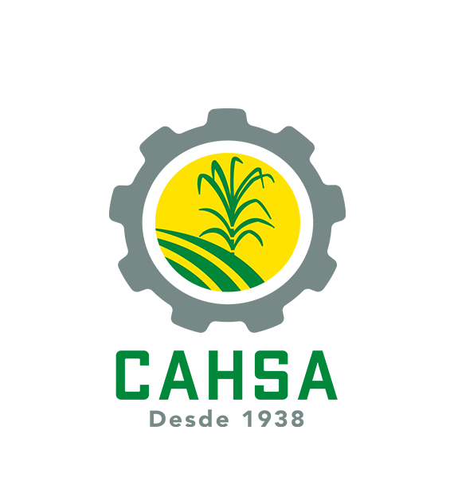

<div align="center">



# 🌿 CAHSA QGIS Plugin

**Plugin de procesamiento geoespacial para CAHSA**  
*Acelera el flujo de trabajo con imágenes Sentinel-2 directamente desde QGIS*


</div>

---

## 📋 Descripción

El **Plugin CAHSA** nace para **aligerar y automatizar** las tareas repetitivas del análisis de imágenes satelitales dentro de los flujos de trabajo de CAHSA. Con un solo clic desde el panel de *Procesamiento* de QGIS, el equipo puede:

- Generar **NDVI** y composiciones **RGB** a partir de bandas Sentinel-2.
- **Pintar mapas de lotes** enlazando datos de un archivo Excel directamente a capas vectoriales.
- **Reclasificar el NDVI** en 14 clases de vegetación y exportar la tabla de atributos.

Todo el proceso que antes requería múltiples pasos manuales ahora corre en segundos dentro del entorno familiar de QGIS.

---

## ✨ Funcionalidades

### 🛰️ 1. Procesar Sentinel-2 — `Procesar Sentinel-2`
Pipeline completo a partir de las bandas crudas del satélite:

| Paso | Descripción |
|------|-------------|
| **Corrección de offset** | Aplica `Banda − 1000` a las bandas B02, B03, B04 y B08 |
| **Recorte por máscara** | Recorta cada banda al polígono de interés (máscara vectorial) |
| **RGB GeoTIFF** | Combina B04 · B03 · B02 en una imagen de color real comprimida (LZW) |
| **Cálculo de NDVI** | `(B08 − B04) / (B08 + B04)` con manejo de NoData |
| **Estilo visual** | Aplica automáticamente un archivo `.qml` de estilo al NDVI |
| **Carga automática** | Agrega los resultados directamente al proyecto de QGIS |

**Entradas requeridas:**
- Máscara vectorial (polígono)
- Bandas raster: **B02** (Azul), **B03** (Verde), **B04** (Rojo), **B08** (NIR)
- Nombre del cuadrante
- Carpeta de salida

**Salidas generadas:**
```
CAHSA/
├── RGB/
│   └── RGB_<nombre>.tif
└── NDVI/
    └── NDVI_<nombre>.tif
```

---

### 🗺️ 2. Pintar Mapas — `Pintar Mapas`
Une datos de un **archivo Excel** a una **capa vectorial de lotes** y aplica simbología categorizada automáticamente.

- Realiza un **reporte de coincidencias** antes de pintar: informa cuántos lotes del Excel se encontraron en la capa y cuáles no.
- Aplica **colores diferenciados** por categoría usando un renderer categorizado.
- Carga la capa resultante directamente en el proyecto activo de QGIS.

**Entradas:**
- Capa vectorial de lotes (polígonos)
- Archivo Excel (cargado como capa vectorial)
- Campo de unión en la capa vectorial
- Campo de unión en el Excel
- Columna con los valores a pintar

---

### 📊 3. Reclasificar NDVI — `Reclasificar NDVI con tabla de atributos`
Convierte un ráster NDVI continuo en **14 clases discretas de vegetación** con conteo de píxeles por clase.

| Clase | Rango NDVI | Descripción |
|-------|-----------|-------------|
| 1 | < 0.0 | Sin vegetación / agua / suelo desnudo |
| 2 | 0.00 – 0.20 | Vegetación muy escasa |
| 3 | 0.20 – 0.30 | Vegetación escasa |
| 4 | 0.30 – 0.40 | Vegetación baja |
| 5 | 0.40 – 0.50 | Vegetación moderada |
| 6 | 0.50 – 0.55 | Vegetación media-baja |
| 7 | 0.55 – 0.60 | Vegetación media |
| 8 | 0.60 – 0.65 | Vegetación media-alta |
| 9 | 0.65 – 0.70 | Vegetación alta |
| 10 | 0.70 – 0.75 | Vegetación muy alta |
| 11 | 0.75 – 0.80 | Vegetación densa |
| 12 | 0.80 – 0.85 | Vegetación muy densa |
| 13 | 0.85 – 0.90 | Vegetación exuberante |
| 14 | 0.90 – 1.00 | Vegetación máxima |

**Salidas:**
- Ráster reclasificado `Reclass_NDVI` (GeoTIFF, Int16)
- Tabla de atributos incrustada en el GeoTIFF (RAT)
- Archivo **CSV** con columnas `OBJECTID`, `Value`, `Count`

---

## 🚀 Instalación

1. Clona o descarga este repositorio.
2. Copia la carpeta `plugin/` a tu directorio de plugins de QGIS:
   - **Linux:** `~/.local/share/QGIS/QGIS3/profiles/default/python/plugins/cahsa/`
   - **Windows:** `%APPDATA%\QGIS\QGIS3\profiles\default\python\plugins\cahsa\`
3. Abre QGIS → **Plugins → Administrar e instalar plugins → Instalados** → activa **CAHSA Plugin**.
4. Los algoritmos aparecerán en la **Caja de herramientas de procesamiento** bajo el grupo **Sentinel-2**.

> **Alternativa:** Instala directamente desde el archivo `cahsa.zip` mediante  
> **Plugins → Instalar desde ZIP**.
> **utilidades/** descarga archivos  `utilidades.zip` contine los layer y shapefiles necesarios para usar el plugin. 

---

## 📦 Requisitos

| Dependencia | Versión mínima |
|-------------|---------------|
| QGIS | ≥ 3.38.0 |
| Python | ≥ 3.9 |
| GDAL | Incluido con QGIS |
| NumPy | Incluido con QGIS |

---

## 🗂️ Estructura del proyecto

```
QGIS_CAHSA/
├── plugin/
│   ├── __init__.py              # Punto de entrada del plugin
│   ├── plugin.py                # Registro del proveedor en QGIS
│   ├── provider.py              # Proveedor de algoritmos de procesamiento
│   ├── procesar_cahsa.py        # Algoritmo: Procesar Sentinel-2 (NDVI + RGB)
│   ├── pintar_mapas_cahsa.py    # Algoritmo: Pintar Mapas desde Excel
│   ├── reclasificar_ndvi.py     # Algoritmo: Reclasificar NDVI (14 clases)
│   ├── metadata.txt             # Metadatos del plugin para QGIS
│   └── icon.png                 # Ícono del plugin
├── utilidades/
│   ├── 00-SHAPE/                # Archivos vectoriales de referencia
│   └── 08-LAYERS/               # Capas de apoyo
├── cahsa.zip                    # Distribución empaquetada del plugin
└── README.md
```

---

## 👥 Colaboradores

Este plugin fue desarrollado por el equipo técnico de CAHSA:

| Colaborador | Rol |
|-------------|-----|
| **Gaspar Tabora Funez** | Desarrollo principal — arquitectura del plugin, integración QGIS, algoritmos de procesamiento |
| **Bella** | Colaboradora — pruebas, validación de flujos y definición de requerimientos |
| **Olman** | Colaborador — pruebas, validación de flujos y definición de requerimientos |
| **Abad** | Colaborador — pruebas, validación de flujos y definición de requerimientos |

---

## 🤝 Contribuciones

Las mejoras y correcciones son bienvenidas. Por favor abre un *issue* o un *pull request* describiendo el cambio propuesto.

---

## 📄 Licencia

Este proyecto es de uso interno de **CAHSA**. Para cualquier consulta sobre licenciamiento, contacta al equipo de desarrollo.

---

<div align="center">
  <sub>Hecho con ❤️ por el equipo CAHSA · Plugin v1.0.4</sub>
</div>
